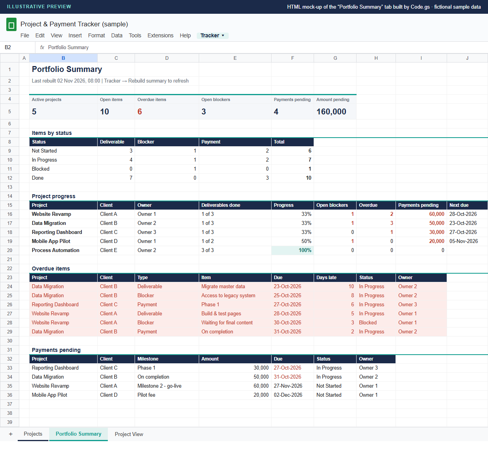

# Google Sheets Project & Payment Tracker

**Turns a plain Google Sheet into a project and payment tracker - one data tab in, a live portfolio summary and per-project view out, rebuilt with one click.**

*Illustrative preview: an HTML mock-up of the "Portfolio Summary" tab, drawn from the fictional sample data in this repo.*

---

## Problem

Small delivery teams often track projects in a shared spreadsheet that slowly turns messy: free-typed statuses, dates in different formats, overdue tasks nobody notices, and payments that are due but not chased. Managers then spend hours each week building a status update by hand.

## What I built

A Google Apps Script (`Code.gs`) that sets up and maintains the whole tracker inside Google Sheets - no extra software or paid tools.

- **One simple data tab - "Projects".** Each row is one item of a project: a **Deliverable**, a **Blocker** or a **Payment**, with client, owner, start and due dates, status, amount and paid-on date.
- **Clean data entry.** Dropdowns for type, status and owner; date checks on date columns; consistent number and date formats.
- **Overdue items highlighted automatically** in red (past due date and not done / not paid).
- **"Portfolio Summary" tab**, built by the script:
  - headline tiles: active projects, open items, overdue items, open blockers, payments pending, amount pending
  - item counts by status and type
  - progress per project (deliverables done, % complete, open blockers, overdue count, payments pending, next due date)
  - a list of every overdue item with days late
  - a list of payments not yet received
- **"Project View" tab** - pick a project from a dropdown and instantly see its deliverables, blockers and payments (live formulas).
- **Custom menu "Tracker"** - *Rebuild summary*, *Rebuild project view*, *Add sample data*, and an optional daily auto-refresh.

## Result

- A weekly status update that used to be compiled by hand is now **one click** (or fully automatic every morning).
- Overdue work and unpaid milestones are **visible at a glance**, so follow-ups happen earlier.
- Everyone enters data the same way, so the numbers can be trusted.
- Anyone on the team can use it - it is just a Google Sheet.

*Based on work in my current role; this version uses synthetic data.*

## Skills shown

- **Google Sheets & Apps Script (JavaScript)** - automation, custom menus, time-driven triggers
- **MIS reporting** - designing a portfolio summary that managers actually read
- **Data quality** - data validation dropdowns, date checks, consistent formats
- **Spreadsheet design** - conditional formatting, FILTER / SORT / COUNTIFS / SUMIFS formulas, dashboard layout
- **Process thinking** - turning a manual weekly routine into a repeatable tool

## What's in this repo

| File | What it is |
|---|---|
| `Code.gs` | The complete Apps Script - paste this into your sheet |
| `sample_data/projects_sample.csv` | Fictional example rows (Client A - Client E) |
| `docs/preview.png` | Illustrative preview of the summary tab |
| `tools/render_preview.py` | Rebuilds the preview image from the sample CSV (Python + Chrome) |

---

## How to set it up (about 5 minutes)

1. Open [Google Sheets](https://sheets.google.com) and create a **blank spreadsheet**.
2. In the menu choose **Extensions &rarr; Apps Script**.
3. Delete the code that is already there, paste in everything from **`Code.gs`**, and click **Save**.
4. In the function dropdown at the top choose **`setupTracker`** and click **Run**. Google will ask you to approve access to *this* spreadsheet - click through and allow.
5. Go back to the sheet. You will now have the **Projects**, **Portfolio Summary** and **Project View** tabs, filled with sample rows, and a new **Tracker** menu (refresh the page if the menu does not appear).
6. Replace the sample rows with your own projects, then use **Tracker &rarr; Rebuild summary**.

Optional: **Tracker &rarr; Refresh summary every morning** rebuilds the summary automatically each day.

Prefer to start from the CSV? Run `setupTracker` first, clear the sample rows, then **File &rarr; Import** `sample_data/projects_sample.csv` into the *Projects* tab (choose "Replace data at selected cell" on cell A1) and rebuild the summary.

To regenerate the preview image: `python tools/render_preview.py` (needs Python 3 and Google Chrome).
